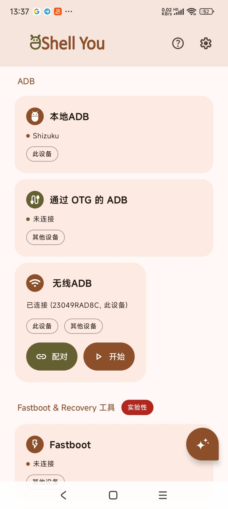
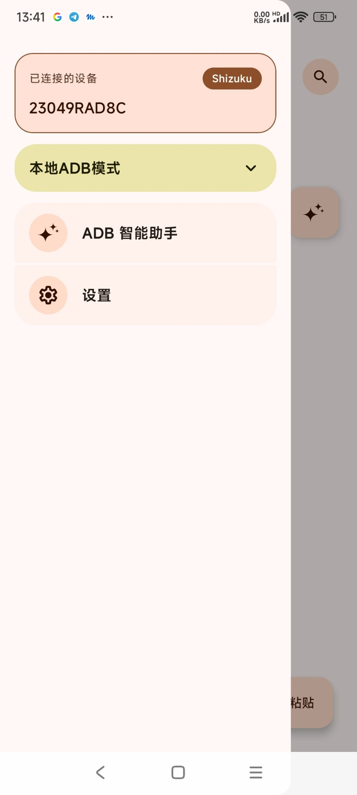
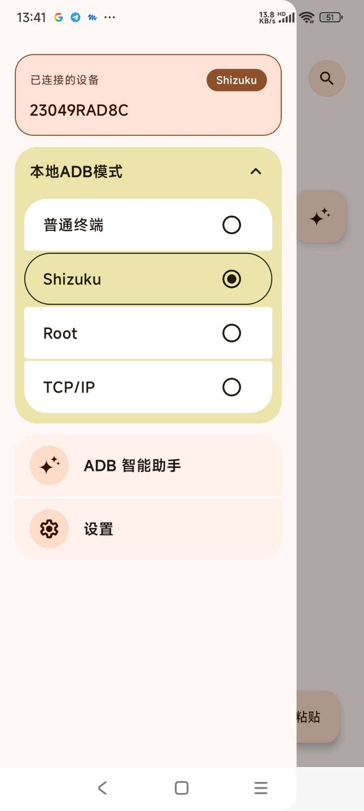

# 修复国行安卓（Android 14+）无法使用 Google 通行密钥（Passkey）

## 症状与原因

**典型症状**

- 在 Chrome 里保存 Passkey / AgeKey 时完全无弹窗、直接卡死，再次点击提示“已有请求正在处理中”
- 在 Telegram 等 App 里提示“无通行密钥应用”

**根本原因**

Android 14 及以上系统把通行密钥独立成了 Credential Manager（凭据管理器）。国行系统（如小米 MIUI / 澎湃 OS）即便开启了 Google 基础服务，底层配置项 `credential_service` 默认仍为空（null），系统找不到接管的应用，自然弹不出保存框。

修复思路就是用 Shizuku 权限手动把这个配置项指向 Google 的服务。无需 Root。

## 准备工作

先装好两个应用（都从官方渠道下载）：

- **Shizuku**：https://github.com/RikkaApps/Shizuku/releases/latest （官网 https://shizuku.rikka.app/zh-hans/ ，也有 Google Play 版）
- **aShell You**（终端工具）：https://github.com/DP-Hridayan/aShellYou/releases

另外确认：

- 手机已设置锁屏密码 / 指纹，且已登录 Google 账号
- 手机能连 Wi-Fi（无线调试要用）

## 第一步：通过无线调试启动 Shizuku

1. 打开开发者选项：设置 → 关于手机 → 连续点击版本号，直到提示已进入开发者模式；然后在开发者选项里打开 **无线调试**。
2. **国行手机先改通知样式**：配对时要靠通知栏输入配对码，国行系统的通知样式会让这个输入框弹不出来。小米 / 澎湃 OS：设置 → 通知与状态栏 → 通知样式 → 改为 **原生样式**；其他品牌在通知设置里找类似选项。
3. 打开 Shizuku，点「通过无线调试启动」区域的 **配对**，按提示点开通知，输入配对码完成配对（配对码在 开发者选项 → 无线调试 → 使用配对码配对设备 里，建议分屏一边看码一边输）。
4. 配对成功后回到 Shizuku，点 **启动**，首页显示“Shizuku 正在运行”即可。

> 每次重启手机后，Shizuku 需要重新启动一次：打开无线调试，进 Shizuku 点启动就行，不用重新配对。

## 第二步：在 aShell You 里连上 Shizuku

1. 在 Shizuku 的「已授权应用」里打开 aShell You 的开关（首次打开 aShell You 时也会弹窗申请，允许即可），然后彻底退出并重开 aShell You。
2. 打开 aShell You，点 **本地ADB**（下面标着 Shizuku、此设备）。

   

3. 进入终端界面后，点左上角 **三条杠** 打开侧边栏，点 **本地ADB模式** 展开，在「普通终端 / Shizuku / Root / TCP/IP」里选 **Shizuku**（侧边栏顶部会显示已连接的设备和 Shizuku 标记，选对了再关掉侧边栏）。

   

   
4. 输入 `id` 回车，确认输出为 `uid=2000(shell)`。
   - 如果后续命令报 Permission Denial 且显示 `uid=10xxx`，说明没走上 Shizuku 权限，回第 1 步重新授权并重启 aShell You。

## 第三步：检查当前配置（可选）

在终端里执行：

```bash
settings get secure credential_service
settings get secure credential_service_primary
```

两条都返回 `null`，即可确认是本文说的问题。

## 第四步：写入 Google 通行密钥服务

直接执行以下两条命令，无报错即成功：

```bash
settings put secure credential_service "com.google.android.gms/com.google.android.gms.auth.api.credentials.credman.service.PasswordAndPasskeyService"
settings put secure credential_service_primary "com.google.android.gms/com.google.android.gms.auth.api.credentials.credman.service.PasswordAndPasskeyService"
```

## 第五步：验证是否生效

- 如果之前 Chrome 已经卡在“已有请求正在处理中”，先去应用管理里把 Chrome **强行停止**，再重新打开。
- 打开 Telegram → 设置 → 隐私和安全 → 通行密钥，或用 Chrome 打开 https://webauthn.io 点 Register 测试。能正常弹出 Google 密码管理器的保存框，就是修复成功。

## 注意事项与排错

- **持久性**：写入后重启手机依然生效；但系统大版本更新后偶尔会被重置为 null，届时重新执行第四步的两条命令即可。
- **能触发请求但一直转圈**：确认代理分流规则没有把 Google Play 服务（com.google.android.gms）设为直连；并在应用管理中为 Google Play 服务开启「后台弹出界面」权限，省电策略设为无限制。
- **恢复默认**：如需撤销修改，执行：

```bash
settings delete secure credential_service
settings delete secure credential_service_primary
```
